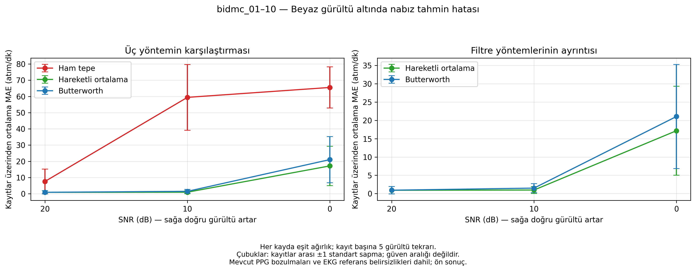

# eem40111

# EEM4011 — Gürültülü PPG’den Nabız Tahmini

BIDMC kayıtlarının parmak PPG sinyallerine beyaz Gauss gürültüsü eklenerek üç nabız tahmin yöntemi karşılaştırılmıştır: ham tepe tespiti, hareketli ortalama ve 0,5–8 Hz Butterworth filtreleme.

## Veri seti

[BIDMC PPG and Respiration Dataset v1.0.0 — PhysioNet](https://physionet.org/content/bidmc/1.0.0/)

Yalnızca bidmc_01–bidmc_10 kayıtlarının CSV sürümü kullanılmıştır. Veri dosyaları bu depoya konulmamıştır.

## Çalıştırma

1. Depodaki `.ipynb` dosyasını Google Colab’da açın.
2. Hücreleri yukarıdan aşağıya çalıştırın. Gerekli kayıtlar PhysioNet’ten okunur.
3. Elle dosya yüklemesi isteyen kurtarma hücreleri, önceki sonuç değişkenleri bellekte mevcutsa atlanabilir.

Defter adım adım geliştirilmiş çalışma sürümüdür; etkileşimli dosya yükleme hücreleri içerir. Paylaşım kopyasında hücre çıktıları temizlenmiştir.

## Deney

- Örnekleme frekansı: 125 Hz
- Değerlendirme: çakışmayan 10 saniyelik pencereler
- Gürültü: 20, 10 ve 0 dB SNR; her düzeyde beş tekrar
- SNR tanımı: pencerenin ortalaması çıkarılmış PPG gücü / eklenen gürültü gücü
- Hareketli ortalama: 13 örnek, 0,104 saniye
- Referans: aynı zaman penceresindeki EKG atım aralıklarından hesaplanan nabız
- Ölçüt: MAE, atım/dk

## Ana sonuçlar

Aşağıdaki değerler, önce her kayıtta beş tekrarın ortalaması alınarak ve ardından on kayda eşit ağırlık verilerek hesaplanmıştır.

| SNR (dB) | Ham tepe MAE | Hareketli ortalama MAE | Butterworth MAE |
|---|---:|---:|---:|
| 20 | 7,6172 | 0,9101 | 0,9248 |
| 10 | 59,4310 | 0,9719 | 1,4959 |
| 0 | 65,5345 | 17,1705 | 21,0519 |

Birim: atım/dk. İki filtre yöntemi de bu koşullarda ham yöntemden düşük ortalama hata vermiştir. İstatistiksel anlamlılık testi yapılmamıştır.

bidmc_01’de yapay gürültü eklenmemiş ham PPG baseline MAE’si 1,7846; Butterworth sonrası MAE 1,5068 atım/dk bulunmuştur.

## Sınırlılıklar

Sonuçlar ön bulgulardır. Kayıtlarda yapay gürültü öncesinde de PPG bozulmaları vardır; deney bütünüyle temiz PPG üzerinde yapılmış kabul edilemez. EKG kanalı, tespit yönü ve eşikleri kayıt özelinde seçilmiştir; referansların tamamı bağımsız olarak doğrulanmamıştır.

bidmc_05 için baseline’da ortak hesaplanabilen 47 pencere, diğer kayıtlarda 48 pencere kullanılmıştır. Hesaplanabilirlik seçimi sinyal kalitesi doğrulaması değildir. Grafikteki hata çubukları kayıtlar arası ±1 standart sapmadır; güven aralığı değildir.
