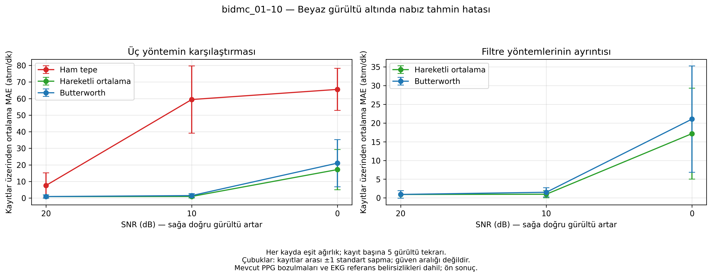
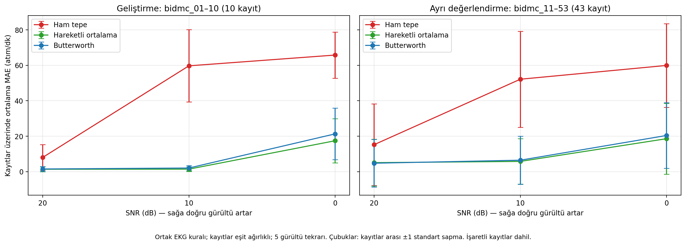
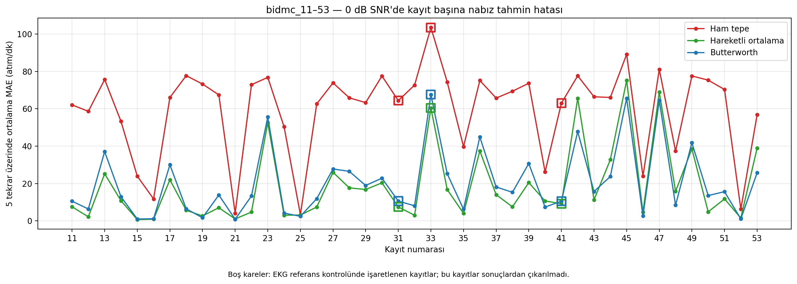

# eem40111

# EEM4011 — Gürültülü PPG’den Nabız Tahmini

BIDMC kayıtlarının parmak PPG sinyallerine beyaz Gauss gürültüsü eklenerek üç nabız tahmin yöntemi karşılaştırılmıştır: ham tepe tespiti, hareketli ortalama ve 0,5–8 Hz Butterworth filtreleme.

## Veri seti

[BIDMC PPG and Respiration Dataset v1.0.0 — PhysioNet](https://physionet.org/content/bidmc/1.0.0/)

Yalnızca bidmc_01–bidmc_10 kayıtlarının CSV sürümü kullanılmıştır. Veri dosyaları bu depoya konulmamıştır.

## Çalıştırma

1. Depodaki `.ipynb` dosyasını Google Colab’da açın.
2. Hücreleri yukarıdan aşağıya çalıştırın. Gerekli kayıtlar PhysioNet’ten okunur.
3. Elle dosya yüklemesi isteyen kurtarma hücreleri, önceki sonuç değişkenleri bellekte mevcutsa atlanabilir.

Defter adım adım geliştirilmiş çalışma sürümüdür; etkileşimli dosya yükleme hücreleri içerir. Paylaşım kopyasında hücre çıktıları temizlenmiştir.

## Deney

- Örnekleme frekansı: 125 Hz
- Değerlendirme: çakışmayan 10 saniyelik pencereler
- Gürültü: 20, 10 ve 0 dB SNR; her düzeyde beş tekrar
- SNR tanımı: pencerenin ortalaması çıkarılmış PPG gücü / eklenen gürültü gücü
- Hareketli ortalama: 13 örnek, 0,104 saniye
- Referans: aynı zaman penceresindeki EKG atım aralıklarından hesaplanan nabız
- Ölçüt: MAE, atım/dk

## Ana sonuçlar

Aşağıdaki değerler, önce her kayıtta beş tekrarın ortalaması alınarak ve ardından on kayda eşit ağırlık verilerek hesaplanmıştır.

| SNR (dB) | Ham tepe MAE | Hareketli ortalama MAE | Butterworth MAE |
|---|---:|---:|---:|
| 20 | 7,6172 | 0,9101 | 0,9248 |
| 10 | 59,4310 | 0,9719 | 1,4959 |
| 0 | 65,5345 | 17,1705 | 21,0519 |

Birim: atım/dk. İki filtre yöntemi de bu koşullarda ham yöntemden düşük ortalama hata vermiştir. İstatistiksel anlamlılık testi yapılmamıştır.

bidmc_01’de yapay gürültü eklenmemiş ham PPG baseline MAE’si 1,7846; Butterworth sonrası MAE 1,5068 atım/dk bulunmuştur.

## Sınırlılıklar

Sonuçlar ön bulgulardır. Kayıtlarda yapay gürültü öncesinde de PPG bozulmaları vardır; deney bütünüyle temiz PPG üzerinde yapılmış kabul edilemez. EKG kanalı, tespit yönü ve eşikleri kayıt özelinde seçilmiştir; referansların tamamı bağımsız olarak doğrulanmamıştır.

bidmc_05 için baseline’da ortak hesaplanabilen 47 pencere, diğer kayıtlarda 48 pencere kullanılmıştır. Hesaplanabilirlik seçimi sinyal kalitesi doğrulaması değildir. Grafikteki hata çubukları kayıtlar arası ±1 standart sapmadır; güven aralığı değildir.
## Güncel ayrı değerlendirme: bidmc_11–53

İlk 10 kayıt geliştirme, sonraki 43 kayıt ayrı değerlendirme için kullanıldı. Ortak EKG aday tespit kuralı geliştirme kayıtlarında kontrol edilip ayrı değerlendirmeden önce sabitlendi. PPG yöntemleri: ham tepe, 13 örneklik hareketli ortalama ve 0,5–8 Hz Butterworth filtresi. Örnekleme frekansı 125 Hz, pencere süresi 10 saniyedir. Her SNR düzeyinde beş beyaz Gauss gürültüsü tekrarı yapıldı.

### Sonuçlar

Değerler, 43 kaydın eşit ağırlıklı MAE ortalaması ± kayıtlar arası standart sapmadır; birim atım/dk’dır.

| Eklenen gürültü | Ham tepe | Hareketli ortalama | Butterworth |
|---|---:|---:|---:|
| Eklenmedi | 4,8964 ± 13,2816 | 5,0751 ± 13,1812 | 4,7573 ± 13,5019 |
| 20 dB | 15,2211 ± 23,0432 | 5,0738 ± 13,1890 | 4,7515 ± 13,4745 |
| 10 dB | 52,1486 ± 27,0779 | 5,7720 ± 12,8145 | 6,4539 ± 13,5898 |
| 0 dB | 59,9270 ± 23,5903 | 18,5825 ± 19,9673 | 20,4016 ± 18,4747 |

### Referans kontrolü ve sınırlılıklar

EKG’den hesaplanan kayıt ortalaması Numerics HR ile karşılaştırıldı. Önceden belirlenen kontrol kuralıyla bidmc_31, bidmc_33 ve bidmc_41 işaretlendi; bu kayıtlar yukarıdaki sonuçlardan çıkarılmadı. Kayıt ortalamalarının uyumu, tek tek EKG tepelerinin doğruluğunu kanıtlamaz.

Yapay gürültü eklenmemiş durumda hareketli ortalamada bir pencerenin tahmini hesaplanamadı; ilgili MAE hesaplanabilen pencerelerden elde edildi. Gürültülü deneylerde eksik karşılaştırma bulunmadı.

Başlangıç sinyalleri mevcut bozulmalar içerir. Deney yalnız eklenen beyaz gürültüyü inceler; hareket artefaktlarının tamamını temsil etmez. İleri–geri filtreleme nedensel değildir; çalışma gerçek zamanlı uygulama iddiası taşımaz. Büyük kayıtlar arası sapmalar nedeniyle yöntemlerin genel üstünlüğü iddia edilmemektedir.

Önceki kayda özel EKG ayarlarıyla hesaplanan Aşama 2 sonuçları, ortak EKG kuralıyla elde edilen bu sonuçlarla doğrudan birleştirilmemelidir.

### Grafikler

Veri dosyaları depoya yüklenmemiştir.
